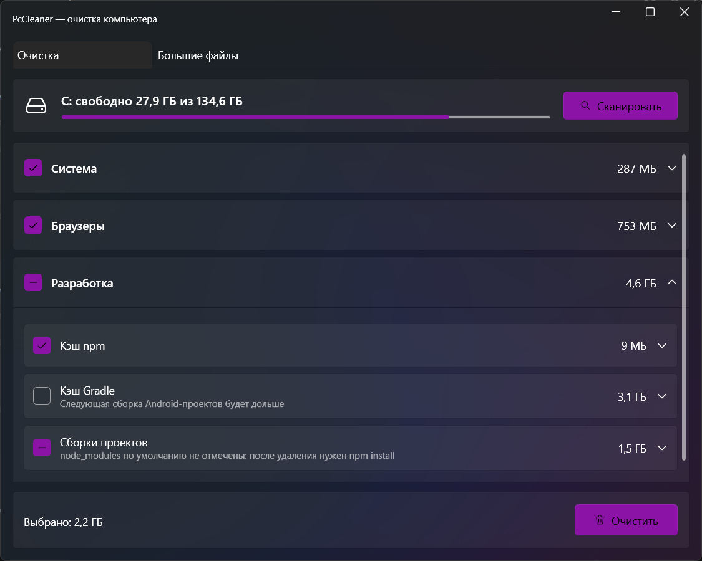

# PcCleaner (бета)

> Бета-версия: программа удаляет файлы — перед первой очисткой просмотрите список найденного.

Утилита для Windows 10/11: находит и удаляет мусор, который не трогает встроенная очистка Windows.



## Что чистит

- **Система** — временные файлы пользователя и Windows, корзина.
- **Браузеры** — только кэш Chrome, Edge и Firefox. Пароли, история, cookies и закладки не трогаются.
- **Разработка** — кэш npm, кэш Gradle (учитывает `GRADLE_USER_HOME`), папки сборок `build`, `bin`, `obj`, `.gradle`, `node_modules` в проектах (по умолчанию `D:\Work`, меняется в `settings.json`).
- **Большие файлы** — отдельная вкладка: топ файлов больше 500 МБ на выбранном диске, удаление только в корзину.

Перед удалением всё показывается списком с размерами. Системные папки, Program Files, «Документы», рабочий стол и `.git` защищены от удаления на уровне кода.

## Установка

Скачайте `PcCleaner-Setup-<версия>.exe` из [последнего релиза](https://github.com/Pashacod/PcCleaner/releases/latest). Установщик спросит папку и нужен ли ярлык на рабочем столе. .NET ставить не нужно — он внутри.

Установщик не подписан, поэтому Windows может показать «Windows защитила ваш компьютер» — нажмите «Подробнее» → «Выполнить в любом случае».

Программа запускается с правами администратора (нужно для `C:\Windows\Temp`). При запуске она проверяет, нет ли новой версии на GitHub, и предлагает обновиться.

## Сборка

Нужны .NET 8 SDK и Inno Setup 7.

```powershell
.\publish.ps1                         # dist\PcCleaner.exe и dist\PcCleaner-Setup-<версия>.exe
.\release.ps1 1.1.0 "Что нового"      # выпуск: версия, тесты, сборка, тег, релиз на GitHub
```

C# · .NET 8 · WPF + [WPF-UI](https://github.com/lepoco/wpfui) · xUnit
